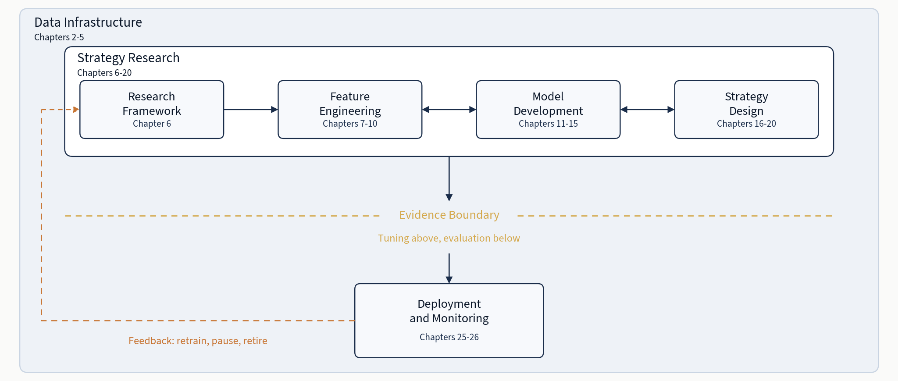

# Machine Learning for Trading（第 3 版）中文导读

**从数据获取到实盘执行，构建、检验并部署由机器学习驱动的交易策略。**

这是 Stefan Jansen 所著 [*Machine Learning for Trading, 3rd Edition*](https://amzn.to/4eigy2F) 的代码仓库。全书围绕一条端到端工作流重新组织，包含 27 章和 9 个案例研究：一个研究想法如何变成可以运行、监控并在真实市场中持续运行的策略。

<p align="center">
  <a href="https://amzn.to/4eigy2F"></a>
</p>

> 这份中文文件是为了提高阅读效率而整理的译本。代码、命令、文件路径和专有名词以仓库原文和实际 notebook 为准。

中文阅读入口：

- **[Notebook 中文导览](docs/zh-CN/notebook-guide.md)**：覆盖全部 484 个 notebook，按章节、案例研究和数据集说明分组。
- **[第 1 章 factor_regimes 中文版](01_process_is_edge/factor_regimes.zh-CN.ipynb)**：完整翻译 Markdown 说明，代码和输出保持不变。
- **[第 1 章 macro_regimes 中文版](01_process_is_edge/macro_regimes.zh-CN.ipynb)**：完整翻译 Markdown 说明，代码和输出保持不变。
- **[第 2 章 CME 期货探索性数据分析 中文版](02_financial_data_universe/04_cme_futures_eda.zh-CN.ipynb)**：完整翻译 Markdown 说明，代码和输出保持不变。

**找第 2 版？** 第 2 版代码完整保留在 `second-edition` 分支中，执行 `git checkout second-edition` 即可切换。那部分目录结构与第 2 版书籍完全对应。

## 目录

- [第 3 版有什么新内容](#第-3-版有什么新内容)
- [九个案例研究](#九个案例研究)
- [课程与工作坊](#课程与工作坊)
- [逐章代码导览](#逐章代码导览)
- [快速开始](#快速开始)
- [配套资源](#配套资源)
- [仓库结构](#仓库结构)

---

## 第 3 版有什么新内容

整本书追踪同一条主线：从数据基础设施和策略研究出发，越过将“调参探索”和“最终评估”分开的**证据边界**，进入部署与监控，并通过反馈循环决定何时重训、暂停或退役一个优势正在衰减的策略。

<p align="center">
  
</p>

旧版更多是按技术逐章推进；第 3 版则把同一个研究到生产的流程完整跑通，并加入大量新内容：

- **更宽的模型工具箱**：从梯度提升（XGBoost、LightGBM、CatBoost），到深度时间序列架构（PatchTST、iTransformer、TSMixer、TCN、Mamba），再到较新的表格模型和潜因子模型（TabPFN、TabM、条件自编码器、监督自编码器）。
- **专门讨论策略设计**：交易成本和风险管理各自成章，与组合构建、策略合成一起，把原始信号推进成有仓位、有成本意识、有风险意识的组合。
- **完整生产链路**：实盘系统（Interactive Brokers、Alpaca、QuantConnect）、MLOps 与治理（漂移检测、安全发布、熔断器、特征库、实验追踪），以及“持续运行”策略的现实运维问题。
- **生成式 AI**：基于 SEC 文件的检索增强生成、知识图谱与 Graph RAG、自治多智能体研究系统。
- **因果机器学习**：Double ML、贝叶斯结构时间序列、因果发现，用来区分真实效应和伪相关。
- **强化学习**：最优执行、带库存约束的做市、深度对冲。
- **合成金融数据**：TimeGAN、Tail-GAN、Sig-CWGAN 和扩散模型生成器，在历史数据不足时辅助验证。

方法论严谨性是全书的一等公民。作者明确区分探索与确认，即“证据边界”；全书使用 walk-forward 交叉验证，并正面处理多重检验和过拟合问题。工具包括 Deflated Sharpe Ratio、Rademacher Anti-Serum、White's Reality Check，以及用于给出诚实不确定性估计的共形预测。

数据层改用 **Polars**，以表达式 API 实现快速数据处理。每章都提供可复现的 **Docker 环境**，让结果跨机器一致。建模与可视化栈还包括 PyTorch、LightGBM、Optuna 和 Plotly。

## 九个案例研究

第 3 版的结构中心是九个贯穿全书的案例研究。ETF、加密货币永续合约、日内股票、期权、外汇、期货和股票因子面板，都走同一条流水线：从原始数据与标签，到特征、模型、回测、成本、风险控制，最后到部署评估。同一个严谨流程应用在九个差异很大的市场上，能清楚看到它何时有效、何时失效以及为什么。

| 案例 | 资产类别 | 频率 | 研究内容 |
|---|---|---|---|
| [ETF](case_studies/etfs/) | 多资产 ETF | 日频 | 100 只 ETF 的跨资产动量与均值回归 |
| [Crypto Perps](case_studies/crypto_perps_funding/) | 加密资产 | 8 小时 | 永续期货资金费率套利 |
| [NASDAQ-100](case_studies/nasdaq100_microstructure/) | 股票 | 15 分钟 | 来自订单流和限价订单簿的日内微观结构信号 |
| [S&P 500 股票与期权](case_studies/sp500_equity_option_analytics/) | 股票与期权 | 日频 | 用隐含波动率特征增强选股 |
| [美国公司特征](case_studies/us_firm_characteristics/) | 股票 | 月频 | 公司层面特征面板：规模、价值、动量、质量 |
| [外汇货币对](case_studies/fx_pairs/) | 外汇 | 日频 | 主要货币对的套息与动量 |
| [CME 期货](case_studies/cme_futures/) | 期货 | 日频 | 商品与金融期货的期限结构和展期收益信号 |
| [S&P 500 期权](case_studies/sp500_options/) | 期权 | 日频 | 纯期权策略：跨式组合、Delta 对冲头寸 |
| [美国股票](case_studies/us_equities_panel/) | 股票 | 日频 | 美股宽横截面与经典因子暴露 |

---

## 课程与工作坊

实时 cohort 课程、一天工作坊和免费分享会都安排在 [Maven](https://maven.com/stefan-jansen)。以下列表来自该日程。

<!-- offerings:all start -->
### Machine Learning for Trading

端到端讲授本仓库实现的工作流。

| 时间 | 课程 | 你会得到什么 |
|---|---|---|
| 自定进度 | [Foundations](https://maven.com/stefan-jansen/ml4t-foundations) | 自己完整搭建 ML for Trading 流水线，并能说明证据支持与不支持什么 |
| 2026-12-03 至 2027-02-18 | [Research to Production](https://maven.com/stefan-jansen/research-to-production) | 把一个研究想法推进成包含成本与监控的策略，并留下可核查的证据链 |
| 2026-12-12 | [ML for Trading in the Age of AI Agents](https://maven.com/stefan-jansen/ml4t-ai-agents) | 从想法到现实交易模拟，完整做一个 ETF 策略 |

**免费直播**，注册者都会收到录像：[Machine learning for trading: choosing the next experiment](https://maven.com/p/b146f5)（10 月 28 日周三，美东 11:00 / UTC 15:00）；[Anatomy of a machine learning for trading case study](https://maven.com/p/bb56cd)（11 月 25 日周三，美东 11:00 / UTC 16:00）

### 智能体系统

设计推理过程可审计的多智能体系统。

| 时间 | 课程 | 你会得到什么 |
|---|---|---|
| 2026-11-21 | [Agent Engineering: Build, Evaluate, and Deploy AI Agents](https://maven.com/stefan-jansen/agent-engineering) | 从智能体基础到可运行的多智能体系统，并配有判断其是否有效的评估框架 |

**免费直播**，注册者都会收到录像：[Multi-Agent AI Systems: When They Help and How to Build Them](https://maven.com/p/393eee)（11 月 11 日周三，美东 11:00 / UTC 16:00）

### 编程智能体

让与你一起写代码的智能体稳定产出可靠工作。

| 时间 | 课程 | 你会得到什么 |
|---|---|---|
| 2026-10-24 | [Stop Micromanaging Your Coding Agent](https://maven.com/stefan-jansen/loop-engineering) | 学会智能体外围框架设计、验证方法，以及坏运行后的恢复 |

**免费直播**，注册者都会收到录像：[Getting better results from coding agents](https://maven.com/p/166231)（10 月 21 日周三，美东 11:00 / UTC 15:00）

课程间歇期，[**Insights** newsletter](https://insights.ml4trading.io/) 每周按来源覆盖相同主题。
<!-- offerings:all end -->

---

## 逐章代码导览

每一章一个目录。每个目录开头的 guide 会把书的章节小节映射到对应 notebook，并列出所需数据。书中不贴代码清单，所以这些 guide 就是章节实现入口：先读书，再打开对应目录。

全书由一章引言、六章工作流主体和一章结论组成。

### 引言

| 章节 | 内容 |
|---|---|
| **[1. The Process Is Your Edge](01_process_is_edge/)** | 为什么流程纪律胜过模型复杂度：ML4T 工作流作为研究到生产系统；因子收益与宏观指标的 regime 识别；区分探索与确认的证据边界。 |

### 第一部分：金融数据（第 2-5 章）

后续章节赖以建立的市场、工具和基础设施：数据源分类，把交易所原始消息转换成可用于特征的价格棒，时点正确的基本面数据，以及用于稳健验证的合成历史数据。

| 章节 | 内容 |
|---|---|
| **[2. The Financial Data Universe](02_financial_data_universe/)** | 八类资产概览，量化幸存者偏差，比较存储格式（Parquet、DuckDB、kdb+、TimescaleDB），并给出全书使用的数据质量框架。 |
| **[3. Market Microstructure](03_market_microstructure/)** | 解析 NASDAQ ITCH，从多个数据源重建限价订单簿，验证 Lee-Ready 交易分类，比较价格棒采样方法；美元棒带来最好的收益正态性。 |
| **[4. Fundamental and Alternative Data](04_fundamental_alternative_data/)** | 时点正确的 SEC EDGAR 管道，跨标识符体系的实体对齐，宏观与商品基本面，以及另类数据评估，包括链上加密数据和预测市场（Kalshi、Polymarket）。 |
| **[5. Synthetic Financial Data](05_synthetic_data/)** | TimeGAN、Tail-GAN、Sig-CWGAN、Diffusion-TS 和基于 LLM 的表格数据生成，并用保真度、效用、隐私框架评估。 |

### 第二部分：研究设计与特征工程（第 6-10 章）

先定义交易问题，再把数据转成模型可用信号：研究设计、标签、特征，以及决定模型能学到什么的评估方式。

| 章节 | 内容 |
|---|---|
| **[6. Strategy Research Framework](06_strategy_definition/)** | 股票池规则、决策日程、成本模型、评估协议与运行日志；引入九个案例研究，以及贯穿第 7 到 20 章的 walk-forward 交叉验证纪律。 |
| **[7. Defining the Learning Task](07_defining_the_learning_task/)** | 前瞻收益、三重屏障、趋势扫描标签；信息系数、分位数分析和可行性筛选；用 BH-FDR 与 Deflated Sharpe Ratio 控制多重检验；因果合理性检查。 |
| **[8. Financial Feature Engineering](08_financial_features/)** | 五类价格特征（动量、反转、波动率、流动性、微观结构），结构与跨品种特征，宏观和日历上下文，以及带稳健性检验的特征选择。 |
| **[9. Model-Based Feature Extraction](09_model_based_features/)** | 从已拟合模型提取特征：平稳性诊断、Kalman 滤波、傅里叶与小波谱特征、GARCH 波动率、HMM regime 概率，且全部保持时点正确。 |
| **[10. Text Feature Engineering](10_text_feature_engineering/)** | 从词袋到 Transformer：TF-IDF、Word2Vec 与 GloVe 嵌入、LSTM 序列模型、FinBERT 情绪分析、金融 NER 微调，以及新闻到收益的信号构建。 |

### 第三部分：模型开发（第 11-15 章）

五类模型族应用在同样九个案例研究上，每一类都建立在线性基线之上。

| 章节 | 内容 |
|---|---|
| **[11. The ML Pipeline](11_ml_pipeline/)** | Ridge、LASSO、Elastic Net 作为后续模型必须超越的基线；方向预测的逻辑回归；SHAP 可解释性；共形预测不确定性；九个案例横向比较。 |
| **[12. Gradient Boosting and Advanced Tabular Models](12_gradient_boosting/)** | XGBoost、LightGBM、CatBoost 与 Optuna 多目标调参；深度表格替代方案 TabPFN 与 TabM；TreeSHAP 可解释性。多数案例中，梯度提升仍是最强表格模型。 |
| **[13. Deep Learning for Time Series](13_dl_time_series/)** | LSTM、N-BEATS、PatchTST、iTransformer、TFT、TSMixer、TCN、Mamba，对照 LTSF-Linear 争论，并给出何时深度模型有帮助的跨数据集证据。 |
| **[14. Latent Factor Models](14_latent_factors/)** | PCA 特征组合、带时变载荷的 IPCA、条件与监督自编码器、对抗 SDF 估计、收益率曲线分解。 |
| **[15. Causal Machine Learning](15_causal_estimation/)** | 用 Double Machine Learning 隔离因子处理效应；用贝叶斯结构时间序列估计事件影响；用 PCMCI、NOTEARS、VAR-LiNGAM 做因果发现。 |

### 第四部分：策略实现（第 16-20 章）

从预测走向可部署策略：回测、组合构建、成本、风险与综合合成。

| 章节 | 内容 |
|---|---|
| **[16. Strategy Simulation](16_strategy_simulation/)** | 把回测视为证伪过程：交易协议规格，向量化与事件驱动引擎，ETF 基线，regime 诊断，以及用 Deflated Sharpe Ratio、Rademacher Anti-Serum、White's Reality Check 控制过拟合。 |
| **[17. Portfolio Construction](17_portfolio_construction/)** | 从分数到组合：均值方差优化及其陷阱、层次风险平价、Kelly 准则、共形仓位 sizing、深度配置，以及受控比较不同分配器。 |
| **[18. Transaction Costs](18_transaction_costs/)** | 成本分类、价差估计、市场冲击校准、执行算法（VWAP、TWAP、Almgren-Chriss）、交易成本分析，以及随资产类别差异很大的盈亏平衡成本。 |
| **[19. Risk Management](19_risk_management/)** | VaR 与 CVaR 尾部度量、回撤和路径风险控制、因子与行业分解、压力测试、自适应风险覆盖、深度对冲、停止开关；覆盖效果高度依赖策略。 |
| **[20. Strategy Synthesis](20_strategy_synthesis/)** | 九个实验对“预测如何变成策略”的启示：IC 与 Sharpe 去相关、基本定律诊断、模型族级联、成本生存分析、留出集失败模式。 |

### 第五部分：高级 AI（第 21-24 章）

面向金融的强化学习、大语言模型、知识图谱与自治智能体。

| 章节 | 内容 |
|---|---|
| **[21. Reinforcement Learning for Execution and Hedging](21_rl_execution_hedging/)** | 金融 MDP 建模；DQN、PPO、SAC；最优执行；带库存管理的做市；用 PFHedge 做深度对冲；逆强化学习恢复策略；仿真到现实差距。 |
| **[22. RAG for Financial Research](22_rag_financial_research/)** | 基于 SEC 文件的检索增强生成：数据摄取、领域嵌入、混合检索与重排、约束式提示、评估与失败诊断，以及向智能体工作流延伸。 |
| **[23. Knowledge Graphs](23_knowledge_graphs/)** | 什么时候图值得投入基础设施成本：从 SEC 文件构图，Graph RAG 做多跳推理，GNN 嵌入与中心性作为 ML 特征，金融网络，以及防止时间泄漏。 |
| **[24. Autonomous Agents](24_autonomous_agents/)** | ReAct、Tree of Thoughts、Reflexion 架构；记忆系统；工具契约；工程栈（LangGraph、Claude SDK）；有状态股票研究智能体；带对抗辩论的多智能体预测；生产可靠性。 |

### 第六部分：生产（第 25-26 章）

把策略推向实盘：交易系统，以及让策略持续运行的运维基础设施。

| 章节 | 内容 |
|---|---|
| **[25. Live Trading Systems](25_live_trading/)** | 连接研究与生产的框架：Interactive Brokers 与 Alpaca 集成，托管平台（QuantConnect），订单生命周期管理，管道验证，运维准备度。 |
| **[26. MLOps and Governance](26_mlops_governance/)** | 失败分类：区分管道分歧与表现衰减；漂移检测；安全模型发布；熔断器；特征库；实验追踪。 |

### 结论

| 章节 | 内容 |
|---|---|
| **[27. The Systematic Edge](27_systematic_edge/)** | 系统化哲学、量化职业路径、学习资源、研究前沿，以及如何建立自己的优势；与第 1 章首尾呼应：流程就是优势。 |

---

## 快速开始

**第一次使用？按顺序读这三份文档。**

1. **[这个仓库是什么、不是什么](docs/what-this-is.md)**：哪些内容一条命令可复现，哪些需要改配置，哪些需要真实算力或授权数据，以及哪些承诺并未给出。安装前先花五分钟读。
2. **[安装](docs/installation.md)**：完整覆盖 Linux、Windows WSL2、macOS、Docker 和 GPU。
3. **[运行 notebook](docs/running-notebooks.md)**：案例流水线、运行日志，以及如何实验而不破坏下载得到的结果。

以下命令都在你自己电脑的终端中执行，不在 GitHub 页面执行，并且必须从**仓库根目录**开始。如果不熟悉命令行，先看 **[Before You Begin](docs/installation.md#before-you-begin)**。

### 1. 克隆并安装

```bash
git clone https://github.com/stefan-jansen/machine-learning-for-trading.git
cd machine-learning-for-trading
cp .env.example .env   # 默认值可直接使用；开始时无需修改
```

然后选择一种环境。**方案 A：Docker**，携带全部依赖，不需要编译器：

```bash
docker compose pull ml4t
```

**方案 B：本地 `uv` 环境**，适用于 macOS、Linux 或 WSL2 内。请用 `uv` 自己的安装器安装，不要用 `pip`；在很多现代系统上 `pip` 安装会缺失或拒绝安装：

```bash
curl -LsSf https://astral.sh/uv/install.sh | sh
source $HOME/.local/bin/env   # 安装器提供的命令；立即把 uv 加入当前 PATH
uv sync
```

方案 B 会从源码编译多个依赖，其中包括 `scikit-learn`，因此需要 C/C++ 编译器和 Python 头文件：Ubuntu、Debian、WSL2 执行 `sudo apt install build-essential python3-dev`；macOS 执行 `xcode-select --install`。磁盘预算约 **16 GB**：环境 11 GB、免费数据集 4 GB、Git 历史 0.9 GB。

| 平台 | 选择 | 原因 |
|---|---|---|
| Linux | 任选 | 两种路径在每个 release 都会被测试 |
| macOS Apple Silicon | **B** | 每个 release 前都在真实硬件走过。Docker 在该平台上主要值得为 12 个预执行的 `ml4t-py312` notebook 和第 2 章容器化数据库基准保留；这些镜像没有 arm64 build |
| macOS Intel | **A** | PyTorch 不发布 macOS x86_64 wheel，本地路径无法解析依赖 |
| Windows | 任选，但**必须 inside WSL2** | 在管理员 PowerShell 执行 `wsl --install -d Ubuntu`，重启后再运行一次；第一次通常只安装 WSL 运行时而没有发行版。之后在 Ubuntu 终端按 Linux 指令操作。直接安装到 Windows Python 不受支持，也无法工作 |

### 2. 下载数据

多数 notebook 需要数据集。先下载免费数据，不需要 API key：

```bash
uv run python data/download_all.py --free-only
```

这会下载七个数据集，约 **4 GB**，需要十二分钟；几乎全部时间用于第 4 章首次需要的公司特征面板。如果想先只用约 75 MB 开始，等章节需要时再下载：

```bash
uv run python data/download_all.py --free-only --skip-firm-characteristics
```

Docker 路径没有宿主 Python：在 Jupyter Lab 终端（**File → New → Terminal**）执行同一命令，但去掉 `uv run`。**[数据指南](data/README.md)** 说明每个数据集、API key 设置、加载器和存储层级。

**可选：预计算结果。** 如果想直接研究第 11-20 章发布的九个案例，而不重新训练，可以下载已验证的 registry、预测、模型文件和回测产物：

```bash
uv run python scripts/download_artifacts.py
```

### 3. 运行 notebook

先用一条命令确认安装。它会为每个组件输出 PASS 或 FAIL，任何必需项失败都会以非零状态退出：

```bash
uv run python scripts/verify_installation.py                     # 方案 B
docker compose run --rm ml4t python scripts/verify_installation.py   # 方案 A
```

Notebook 采用成对的 [Jupytext](https://jupytext.readthedocs.io/) 文件：一个 `.py` 源文件和一个生成的 `.ipynb`。`uv sync` 已安装 Jupyter Lab。从仓库根目录按以下两种路径之一启动：

```bash
# 方案 B：本地 uv。完整复制并打开它打印的带 token URL。
ML4T_DATA_PATH="${ML4T_DATA_PATH:-$PWD/data}" uv run jupyter lab

# 方案 A：Docker。之后在浏览器打开 http://localhost:8888，无需 token。
docker compose up ml4t
```

本地路径中的 `ML4T_DATA_PATH` 前缀会给加载器一个绝对路径。原因是 Jupyter 会把每个 notebook 的工作目录设为其章节目录；没有这个前缀时，加载器会在章节目录里找数据，并报告数据缺失。该写法保留你已导出的值，未导出时默认用仓库的 `data/`。Docker 路径不需要前缀，因为 compose 文件已在容器内设置该变量。更多首跑说明、案例流水线、Papermill 参数和实验流程见 **[running notebooks](docs/running-notebooks.md)**。

### Docker 镜像

多数 notebook 使用默认 **ml4t** 镜像；少数需要专用镜像，相关 notebook 会在开头说明。完整信息见 **[Docker environments guide](envs/README.md)**。

| 镜像 | 覆盖范围 | 何时需要 |
|---|---|---|
| `ml4t` | 全部 27 章 + 9 个案例研究（CPU） | 默认选择 |
| `ml4t-gpu` | 同 `ml4t`，用 NVIDIA runtime 运行（`--profile gpu`） | 深度学习章节 |
| `ml4t-py312` | Python 3.12，用于 signatory、esig、gensim、tfcausalimpact | 约 10 个 notebook |
| `benchmark` | 数据库客户端（TimescaleDB、ClickHouse、QuestDB、InfluxDB） | 第 2 章存储基准 |
| `rapids` | RAPIDS cuML + LightGBM CUDA（本地构建） | 第 12 章一个 GPU 基准 |

---

## 配套资源

[配套网站](https://ml4trading.io) 提供三类章节依赖但不在书中重复的内容。

- **[112 篇 primer](https://ml4trading.io/primer/)**：免费开放的一页式概念说明，覆盖章节默认你已知的内容，例如限价订单簿机制、双时间数据模型、分数差分、因子研究中的多重检验、共形预测、Deflated Sharpe Ratio、层次风险平价、Almgren-Chriss 执行、walk-forward 验证。无需安装，无需注册。
- **[61 个 agent skills](https://ml4trading.io/skills/)**：面向编程智能体的任务配方。每个 skill 都带有人工执行时同样需要的防前视偏差、防泄漏、防多重检验约束，覆盖研究循环：构建价格棒和三重屏障标签、特征选择、purged walk-forward CV、成本模型与 tear sheet、仓位 sizing、停止开关、实盘监控。浏览目录免费；打开 skill 详情需要网站账号。
- **[六个 Python 库](https://ml4trading.io/libraries/)**：承载 notebook 所依赖的流水线，每个库对应一个工作流阶段。它们都是可独立使用的生产级包：

| 库 | 阶段 | 作用 |
|---|---|---|
| [`ml4t-data`](https://ml4trading.io/docs/data/) | 数据 | 用一个接口统一接入 19+ 家市场数据供应商 |
| [`ml4t-engineer`](https://ml4trading.io/docs/engineer/) | 信号 | 特征、标签、另类价格棒，以及防泄漏数据集准备 |
| [`ml4t-models`](https://ml4trading.io/docs/models/) | 模型 | 金融原生潜因子、SDF、直接预测与组合学习 |
| [`ml4t-diagnostic`](https://ml4trading.io/docs/diagnostic/) | 评估 | 特征验证、策略诊断、Deflated Sharpe Ratio |
| [`ml4t-backtest`](https://ml4trading.io/docs/backtest/) | 策略 | 带现实执行假设的事件驱动回测 |
| [`ml4t-live`](https://ml4trading.io/docs/live/) | 部署 | 带券商集成的生产交易 |

---

## 仓库结构

```text
machine-learning-for-trading/
├── 01_process_is_edge/ … 27_systematic_edge/   27 章，Jupytext .py + .ipynb，每章有 README
├── case_studies/     九个数据集完整走完流水线（第 6 → 20 章）
├── data/             每个数据集的下载脚本和加载器               → data/README.md
├── utils/            共享配置、路径、样式、建模和交叉验证代码    → utils/README.md
├── scripts/          阅读工具：安装检查、notebook 同步、产物下载 → scripts/README.md
├── tests/            Papermill notebook 执行 + 单元守护，CI 中运行 → tests/README.md
├── envs/             所有镜像的 Dockerfile                       → envs/README.md
├── docs/             仓库定位、安装和 notebook 执行指南
├── docker-compose.yml    所有 Docker 服务
├── pyproject.toml · uv.lock    固定依赖（uv）
└── matplotlibrc      图形样式，从仓库根目录自动应用
```

---

## 贡献与反馈

发现错误、失效链接，或有建议？书籍发布前的早期反馈尤其有价值。

- **Issue**：[打开 GitHub issue](https://github.com/stefan-jansen/machine-learning-for-trading/issues)
- **网站与联系**：[ml4trading.io](https://ml4trading.io)

---

## 许可

代码采用 [MIT License](LICENSE)。书籍内容 © 2026 Stefan Jansen，保留所有权利。

`data/equities/market/sp500/daily_bars.parquet` 版权归 AlgoSeek LLC 所有，经 AlgoSeek 授权为本书读者在此再分发。AlgoSeek 保留该文件全部权利；如果你基于它发表内容，请引用 [algoseek.com](https://algoseek.com) 作为来源。MIT 许可只覆盖代码，不覆盖这个数据文件。详见 [data/README.md](data/README.md#attribution)。

<p align="center">
  <a href="https://amzn.to/4eigy2F">购买书籍</a> •
  <a href="https://ml4trading.io">ml4trading.io</a> •
  <a href="https://github.com/stefan-jansen/machine-learning-for-trading">GitHub</a>
</p>
